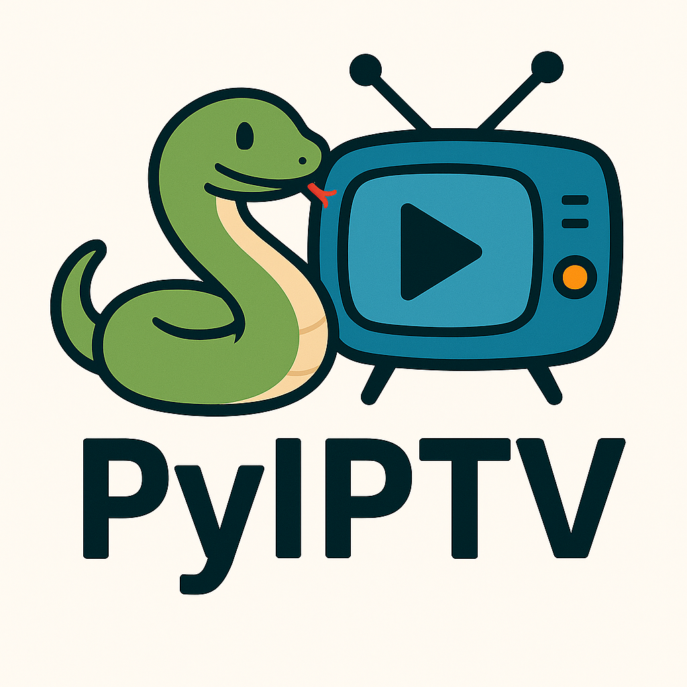

<div align="center">
  
  
  # PyIPTV
  
  **A Modern Python IPTV Player**
  
  [](https://www.python.org/downloads/)
  [](https://opensource.org/licenses/MIT)
  [](https://www.qt.io/)
  [](https://github.com/dmarkey/PyIPTV/graphs/commit-activity)
  
  *Feature-rich IPTV player built with PySide6/Qt6 for streaming live television content from M3U playlists*
</div>

---

## ✨ Features

### Core Functionality
- 📺 **M3U Playlist Support** - Load and manage IPTV playlists in M3U format
- 📡 **Xtream Codes API** - Native support for Xtream-panel providers with server-side categories and on-device caching
- 🎨 **Modern Qt6 Interface** - Built with PySide6 for a responsive, native desktop experience
- 📂 **Category Organization** - Automatically organize channels by categories
- 🔍 **Search & Filtering** - Quickly find channels with real-time search
- 🎵 **Audio Track Selection** - Multi-language audio track support

### User Experience
- 🌓 **Theme Support** - System-aware theming with KDE integration
- ⚡ **Performance Optimized** - Handles large playlists with virtualized lists and smart buffering
- ⚙️ **Settings Management** - Persistent settings with user-friendly configuration
- 🖥️ **High DPI Support** - Optimized for high-resolution displays

## 🚀 Installation

### From PyPI (Recommended)

```bash
pip install pyiptv
```

### Using uvx (Isolated execution)

```bash
uvx pyiptv
```

### From Source

```bash
git clone https://github.com/dmarkey/PyIPTV.git
cd PyIPTV
pip install -e .
```

## 📖 Usage

### Basic Usage

Launch PyIPTV without arguments to open the playlist manager:

```bash
pyiptv
```

### Direct Playlist Loading

Launch directly with a playlist file:

```bash
pyiptv /path/to/your/playlist.m3u
```

### Command Line Arguments

| Command | Description |
|---------|-------------|
| `pyiptv` | Launch with playlist manager |
| `pyiptv <playlist_path>` | Launch directly with specified playlist |

## 📋 Requirements

| Component | Version | Description |
|-----------|---------|-------------|
| Python | 3.8+ | Core runtime |
| PySide6 | 6.5.0+ | Qt6 bindings |
| Qt6 multimedia libraries | Latest | Media playback |
| Operating System | Linux, Windows, macOS | Cross-platform support |

### System Dependencies

<details>
<summary><strong>🐧 Linux (Ubuntu/Debian)</strong></summary>

```bash
sudo apt install python3-pip qt6-multimedia-dev
```
</details>

<details>
<summary><strong>🎩 Linux (Fedora/CentOS)</strong></summary>

```bash
sudo dnf install python3-pip qt6-qtmultimedia-devel
```
</details>

<details>
<summary><strong>🍎 macOS</strong></summary>

```bash
brew install python qt6
```
</details>

<details>
<summary><strong>🪟 Windows</strong></summary>

No additional system dependencies required - PySide6 includes all necessary Qt libraries.
</details>

## ⚙️ Configuration

PyIPTV automatically creates configuration files in platform-appropriate locations:

| Platform | Configuration Path |
|----------|-------------------|
| **Linux** | `~/.config/PyIPTV/pyiptv_settings.json` |
| **Windows** | `%APPDATA%/PyIPTV/pyiptv_settings.json` |
| **macOS** | `~/.config/PyIPTV/pyiptv_settings.json` |

### Available Settings

- **Theme Mode** - System auto-detection, light, or dark themes
- **Buffering** - Adjustable buffering time for smooth playback
- **Performance** - Options for handling large playlists
- **UI Preferences** - Window geometry, splitter sizes, and more

## 📝 Playlist Format

PyIPTV supports standard M3U playlist format with extended information:

```m3u
#EXTM3U
#EXTINF:-1 tvg-id="channel1" tvg-name="Channel Name" tvg-logo="logo.png" group-title="Category",Channel Display Name
http://example.com/stream1.m3u8
#EXTINF:-1 tvg-id="channel2" tvg-name="Another Channel" group-title="Movies",Movie Channel
http://example.com/stream2.m3u8
```

## 📡 Xtream Codes Sources

PyIPTV talks to Xtream-panel providers natively — no need to hand-build an M3U URL.

### Adding a source

1. Open the Playlist Manager (`Ctrl+P` or the initial launch window).
2. Click **Add Playlist** and pick **Xtream Codes**.
3. Enter:
   - **Server** — `http://host:port` (or `https://`)
   - **Username**
   - **Password**
4. Save. The dialog authenticates against `player_api.php` before committing, so invalid credentials are rejected up front.

### How it works

| Piece | Detail |
|---|---|
| API | `player_api.php` — `get_live_categories`, `get_live_streams`, `get_short_epg` |
| Stream URLs | Constructed client-side as `{server}/live/{user}/{pass}/{stream_id}.{ext}` |
| Cache | Transformed channel list is pickled under `~/.config/PyIPTV/playlist_cache/xtream_<hash>.pkl` with a **6-hour TTL** — second open is instant and survives brief network outages (falls back to the stale cache on fetch failure) |
| Refresh | Right-click the playlist in the manager → **Refresh Xtream Source** to invalidate the cache and re-fetch |

### Scope & limitations

- **Live TV only** — VOD and series are not yet surfaced (planned).
- **EPG** — `get_short_epg` is wired up and cached in memory, but no guide UI is shown yet (planned).
- **Credential storage** — username and password are stored **in plaintext** in `~/.config/PyIPTV/playlists.json`, matching the existing settings-file pattern. If that's a concern for your environment, use a dedicated account with low `max_connections` and a unique password.
- **CDN user-agent** — Qt's media backend sends its own UA when fetching stream URLs. Some Cloudflare-fronted providers reject non-browser UAs. API calls are unaffected (the client sends a browser UA), but if playback fails with resource/network errors on every channel, the provider is likely UA-gating streams and a local proxy would be required (not implemented yet).

## 🏗️ Architecture

PyIPTV follows a modular architecture design:

```
┌─────────────────┐
│ Main Application│
├─────────────────┤
│ UI Components   │
│ Playlist Manager│
│ Media Player    │
│ Settings Manager│
│ Theme Manager   │
└─────────────────┘
```

### Components

- **Main Application** - Entry point and application lifecycle management
- **UI Components** - Modular Qt widgets for different functionality
- **Playlist Manager** - M3U parsing and playlist management
- **Media Player** - Qt6 multimedia integration
- **Settings Manager** - Configuration persistence
- **Theme Manager** - System-aware theming

## 🛠️ Development

### Setting up Development Environment

```bash
git clone https://github.com/dmarkey/PyIPTV.git
cd PyIPTV
pip install -e ".[dev]"
```

### Running Tests

```bash
pytest
```

### Code Formatting

```bash
black pyiptv/
isort pyiptv/
```

### Linting

```bash
flake8 pyiptv/
```

## 🔧 Troubleshooting

### Common Issues

| Issue | Solution |
|-------|----------|
| Video playback problems | Ensure Qt6 multimedia libraries are installed |
| Theme not applying correctly | Check desktop environment compatibility |
| Performance issues with large playlists | Adjust performance settings in configuration |

### Debug Mode

Run with debug information:

```bash
PYTHONPATH=. python -m pyiptv.main --debug
```

## 🤝 Contributing

Contributions are welcome! Please feel free to submit a Pull Request. For major changes, please open an issue first to discuss what you would like to change.

### Development Guidelines

- Follow PEP 8 style guidelines
- Add tests for new features
- Update documentation as needed
- Ensure compatibility with supported Python versions

## 📄 License

This project is licensed under the MIT License - see the [LICENSE](LICENSE) file for details.

## 🙏 Acknowledgments

- Most of the codebase for PyIPTV was generated by Claude Sonnet 4
- Built with [PySide6](https://doc.qt.io/qtforpython/) - Qt for Python
- Inspired by the need for a modern, cross-platform IPTV player
- Thanks to the open-source community for tools and libraries

## 📞 Support

- **Issues**: [GitHub Issues](https://github.com/dmarkey/PyIPTV/issues)
- **Discussions**: [GitHub Discussions](https://github.com/dmarkey/PyIPTV/discussions)
- **Email**: david@dmarkey.com

---

<div align="center">
  
**⚠️ Legal Notice**

*This software is for personal use with legally obtained IPTV content. Users are responsible for ensuring they have appropriate rights to access any content streams.*

</div>